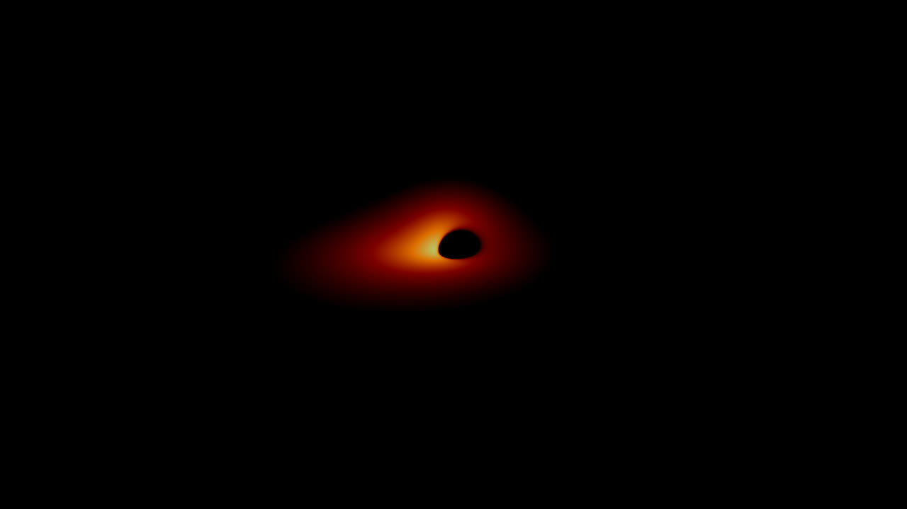
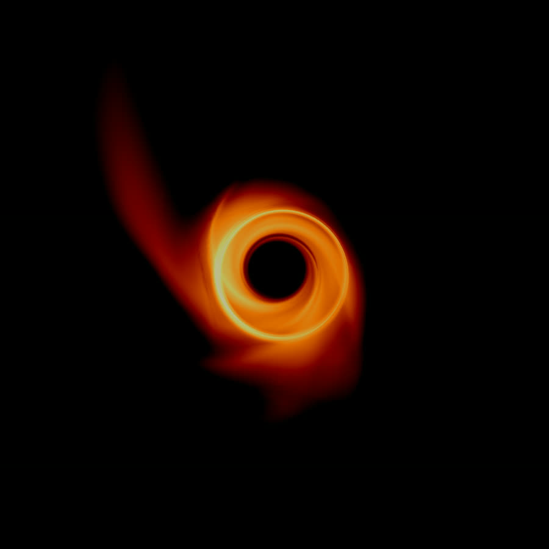
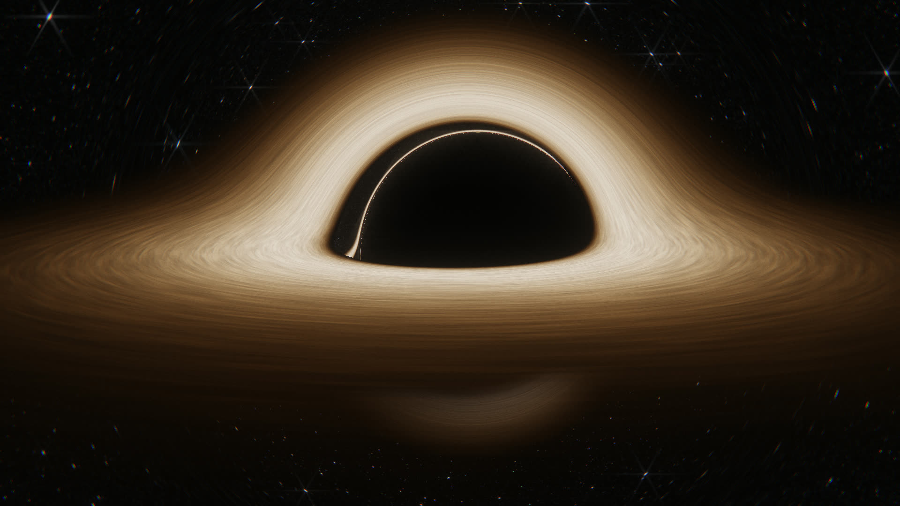

# black-hole-sim

A black-hole simulator built one version at a time, **from Newton to Interstellar**: it starts as Newton + Euler in 2D and ends as a real-time Kerr ray tracer on the GPU, with an interactive panel, a flight mode with thrusters, radio images from a GRMHD simulation and an X-ray view. Every version still builds and runs, and every new piece of physics was checked against an independent oracle before it was trusted.



*X-ray view: a point corona on the spin axis (h = 3 M) lights the disk of a spinning hole (a = 0.9, inclination 70°); bolometric reflected intensity, plunging region included.*

| | |
|---|---|
|  |  |
| Radio image of our own GRMHD simulation (MAD, a = 0.9375) | The "Interstellar look" preset (artistic, labelled as such in the app) |

## What it does

- **Metrics:** Schwarzschild, Kerr (exact Carter geodesics), Kerr-Newman, Reissner-Nordström and the naked singularity, Schwarzschild-de Sitter, the Ellis and Interstellar wormholes (two skies).
- **Emission:** thin Novikov-Thorne / Page-Thorne disk with limb darkening and colour correction; thick disk with radiative transfer; turbulence and a hot spot with slow light; Fishbone-Moncrief torus and parametric RIAF in thermal synchrotron; GRMHD snapshots (the Illinois library and our own AthenaK run) calibrated in Jy to M87* and Sgr A*; spherical inflow; jet walls; X-ray lamppost reflection (bolometric or a power-law band, reflection fraction).
- **Rendering:** CUDA kernels in float or double, adaptive DP45 / DOP853 integration with an analytic escape tail, progressive samples, bloom and ACES, HDR10 video, an optional OptiX denoiser.
- **Interaction:** a Dear ImGui panel with every version and variant labelled by epistemic status (observed, model-dependent, hypothetical, aesthetic); camera orbit; a flight mode on Kerr geodesics with thrusters, orbital controls and an autopilot.
- **Validation:** an independent analytic oracle for Kerr light rays (Gralla & Lupsasca 2020), golden images, photon-number conservation, comparisons with published numbers; about 40 CTest suites and a CPU core library with ~190 test cases.

## Build

Linux with an NVIDIA GPU and the CUDA toolkit (developed on an RTX 5080 with CUDA 13.x; set `-DBHS_CUDA_ARCH` for other cards). The core library and the CPU versions build without a GPU, also on macOS.

```bash
code/tools/fetch_imgui.sh            # Dear ImGui (the interactive panel)
code/tools/fetch_sky.sh              # NASA star map, ~125 MB (optional: without it the sky is black)
code/tools/fetch_optix.sh            # optional: OptiX headers for the denoiser (NVIDIA licence)
cmake -S code -B code/build -DCMAKE_BUILD_TYPE=Release
cmake --build code/build -j
ctest --test-dir code/build          # every suite (needs the GPU)
code/build/core/bhs_core_tests       # the CPU core only
```

## Run

```bash
cd code
build/apps/v4_0-metric-api/v4_0-metric-api            # interactive: the panel lists every version and variant
build/apps/v4_0-metric-api/v4_0-metric-api --help     # every option
build/apps/v4_0-metric-api/v4_0-metric-api --a 0.9 --theta 70 --size 1920x1080 --shot disk.png
build/apps/v4_0-metric-api/v4_0-metric-api --disk-model lamppost --lamppost-h 3 --lamppost-plunge --shot xray.png
```

In the window: drag to orbit, the wheel for the distance, **F1** hides the panel, **F** flies the ship, **Esc** quits; everything else is in the panel.

### Data

Large inputs are not in Git. They live in `data/` at the root of the repository (or wherever `BHS_DATA` points):

- **Illinois GRMHD library snapshots**: `code/tools/fetch_grmhd.sh MAD 0 5500`, then `code/tools/convert_grmhd.py` into `data/bgm/`.
- **Our own GRMHD run**: see [athenak/](athenak/README.md) (AthenaK, about 18 h on one GPU); the converted snapshots go to `data/athenak/run_d/bgm_hi/`.

## Layout

| Folder | What |
|---|---|
| `code/core/` | the physics library (header-only C++20): geodesics, disks, the analytic oracle, GRMHD readers, the lamppost model; CPU tests |
| `code/apps/` | **one folder per milestone**, each with the code of that version (`v0_1-newton-euler` … `v2_x-variants-cuda`), the frozen `v3_1-kerr-cuda-ui` (oracle of the golden images) and the current app `v4_0-metric-api` |
| `code/tools/` | fetch scripts, converters, validation and benchmark scripts, the timelapse pipeline |
| `code/tests/` | golden images and end-to-end tests |
| `docs/physics/` | the physics and engineering notes written along the way (decisions, derivations, measurements, failed attempts) |
| `docs/REFERENCES.md` | the papers, codes and data used, with links |
| `athenak/` | how our GRMHD simulation was built and run |

## Versions

| Version | What you see | New technique |
|---|---|---|
| v0.1 | 2D particles in orbit | Newton with Euler, Verlet and RK4; energy drift |
| v0.2 | 2D light bending | Schwarzschild null geodesics (Binet) |
| v0.3 | 3D shadow | CPU ray tracer |
| v0.4 | Accretion disk | ISCO, black body, redshift and Doppler |
| v0.5 | Real time | GLSL compute shader, NASA HDR sky |
| v0.6 | Rotating black hole | Kerr in Mino time, adaptive RK45, CUDA port |
| v0.7 | Cinematic GPU | Novikov-Thorne LUT, moving observer, bloom, ACES, video |
| v0.8 | Flight | timelike geodesics with thrust, HUD; OptiX denoiser (measured: not worth it) |
| v0.9 – v2.7 | Thick disk, turbulence, offline routes, radio and GRMHD, Kerr-Newman, de Sitter, wormhole, HDR10 | see `docs/physics/` |
| v3.1 | Interactive UI | Dear ImGui panel with epistemic-status badges |
| v4.0 | Refactor and refinement | Metric / DiskModel / Observer templates, analytic oracle, faster float path, asynchronous GRMHD playback, spherical inflow, jets, X-ray lamppost, orbit-assisted flight |

## Licence

MIT (see [LICENSE](LICENSE)). Third-party code and data keep their own licences and are fetched, not redistributed: see [CREDITS.md](CREDITS.md). If you use this work, please also cite what it builds on ([CITATION.cff](CITATION.cff), [docs/REFERENCES.md](docs/REFERENCES.md)).
